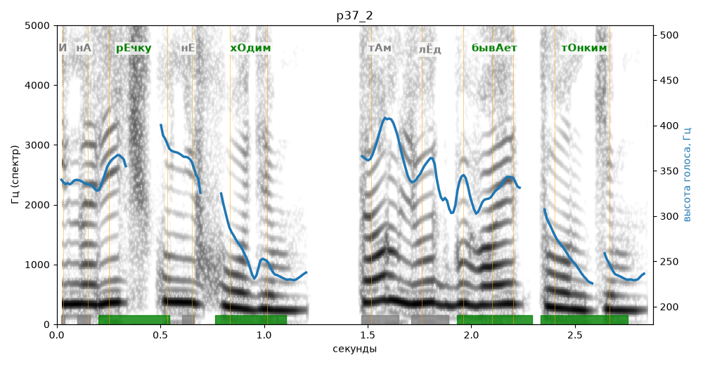

# p37_2

Голос: **Mac Milena** · длительность 2.9 с
Естественность (UTMOS): **2.22 из 5** (живой диктор ≈ 4–4.5)
Эталон: И на речку не ходим. Там лёд бывает тонким.
Распознано: и на речку не ходим. Там лёд бывает тонким.
Слова: все совпали

## Ударения
(где нужно: ruaccent)

| слово | нужно | у голоса | |
|---|---|---|---|
| речку | рЕчку | рЕчку | ✓ |
| ходим | хОдим | хОдим | ✓ |
| бывает | бывАет | бывАет | ✓ |
| тонким | тОнким | тОнким | ✓ |

## Интонация
- ✓ «и на речку не ходим.» — конец фразы понижается — звучит законченно
- ✓ «там лёд бывает тонким.» — конец фразы понижается — звучит законченно
- Диапазон голоса 9.1 полутонов (живо), средняя высота 327 Гц

## Паузы и темп
- паузы на своих местах
- Темп 5.9 слога/с (нормально)

_Синяя линия — высота голоса. Над словами заглавная буква — где ударение должно быть; красным — голос поставил не туда (уверенно), оранжевым — возможно._
