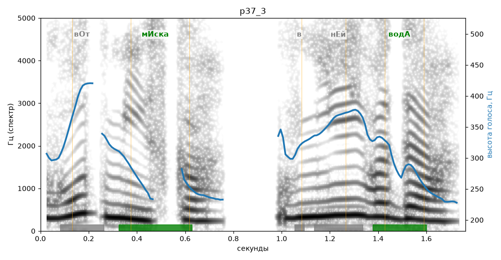

# p37_3

Голос: **Mac Milena** · длительность 1.8 с
Естественность (UTMOS): **2.74 из 5** (живой диктор ≈ 4–4.5)
Эталон: Вот миска. В ней вода.
Распознано: Вот миска, в ней вода.
Слова: все совпали

## Ударения
(где нужно: ruaccent)

| слово | нужно | у голоса | |
|---|---|---|---|
| миска | мИска | мИска | ✓ |
| вода | водА | водА | ✓ |

## Интонация
- ✗ «вот миска.» — конец фразы не понижается — звучит незаконченно / как перечисление
- ✓ «в ней вода.» — конец фразы понижается — звучит законченно
- Диапазон голоса 8.9 полутонов (живо), средняя высота 305 Гц

## Паузы и темп
- паузы на своих местах
- Темп 6.4 слога/с (нормально)

_Синяя линия — высота голоса. Над словами заглавная буква — где ударение должно быть; красным — голос поставил не туда (уверенно), оранжевым — возможно._
