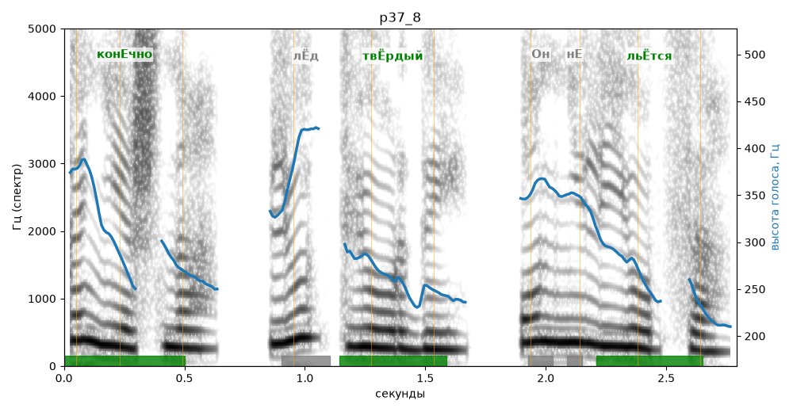

# p37_8

Голос: **Mac Milena** · длительность 2.8 с
Естественность (UTMOS): **2.61 из 5** (живой диктор ≈ 4–4.5)
Эталон: Конечно. Лёд твёрдый. Он не льётся.
Распознано: Конечно, лют твердый, он не льется.
Расхождения в словах: «лед» → «лют»

## Ударения
(где нужно: ruaccent)

| слово | нужно | у голоса | |
|---|---|---|---|
| конечно | конЕчно | конЕчно | ✓ |
| твёрдый | твЁрдый | твЁрдый | ✓ |
| льётся | льЁтся | льЁтся | ✓ |

## Интонация
- ✗ «конечно.» — конец фразы не понижается — звучит незаконченно / как перечисление
- ✗ «лёд твёрдый.» — конец фразы не понижается — звучит незаконченно / как перечисление
- ✓ «он не льётся.» — конец фразы понижается — звучит законченно
- Диапазон голоса 9.6 полутонов (живо), средняя высота 283 Гц

## Паузы и темп
- паузы на своих местах
- Темп 5.2 слога/с (нормально)

_Синяя линия — высота голоса. Над словами заглавная буква — где ударение должно быть; красным — голос поставил не туда (уверенно), оранжевым — возможно._
