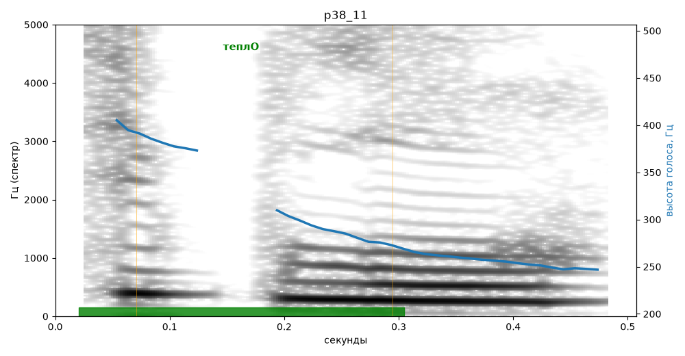

# p38_11

Голос: **Mac Milena** · длительность 0.5 с
Естественность (UTMOS): **2.45 из 5** (живой диктор ≈ 4–4.5)
Эталон: Тепло!
Распознано: тепло.
Слова: все совпали

## Ударения
(где нужно: ruaccent)

| слово | нужно | у голоса | |
|---|---|---|---|
| тепло | теплО | теплО | ✓ |

## Интонация
- Диапазон голоса 8.0 полутонов (живо), средняя высота 273 Гц

## Паузы и темп
- паузы на своих местах
- Темп 7.0 слога/с (быстро)

_Синяя линия — высота голоса. Над словами заглавная буква — где ударение должно быть; красным — голос поставил не туда (уверенно), оранжевым — возможно._
