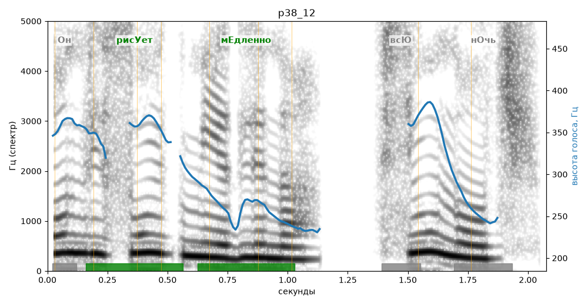

# p38_12

Голос: **Mac Milena** · длительность 2.1 с
Естественность (UTMOS): **2.8 из 5** (живой диктор ≈ 4–4.5)
Эталон: Он рисует медленно. Всю ночь.
Распознано: Он рисует медленно, всю ночь.
Слова: все совпали

## Ударения
(где нужно: ruaccent)

| слово | нужно | у голоса | |
|---|---|---|---|
| рисует | рисУет | рисУет | ✓ |
| медленно | мЕдленно | мЕдленно | ✓ |

## Интонация
- ✓ «он рисует медленно.» — конец фразы понижается — звучит законченно
- Диапазон голоса 8.0 полутонов (живо), средняя высота 291 Гц

## Паузы и темп
- паузы на своих местах
- Темп 5.8 слога/с (нормально)

_Синяя линия — высота голоса. Над словами заглавная буква — где ударение должно быть; красным — голос поставил не туда (уверенно), оранжевым — возможно._
