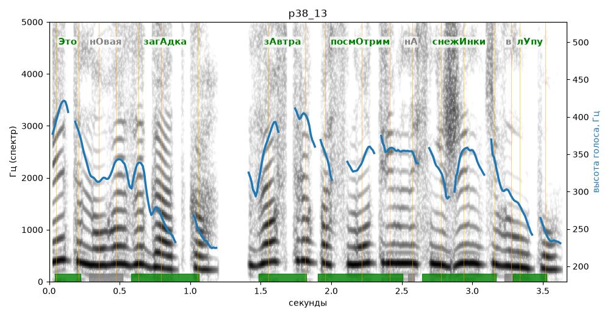

# p38_13

Голос: **Mac Milena** · длительность 3.7 с
Естественность (UTMOS): **2.35 из 5** (живой диктор ≈ 4–4.5)
Эталон: Это новая загадка. Завтра посмотрим на снежинки в лупу!
Распознано: Это новая загадка, завтра посмотрим на снежинки в лупу.
Слова: все совпали

## Ударения
(где нужно: ruaccent)

| слово | нужно | у голоса | |
|---|---|---|---|
| это | Это | Это | ✓ |
| новая | нОвая | — | ? |
| загадка | загАдка | загАдка | ✓ |
| завтра | зАвтра | зАвтра | ✓ |
| посмотрим | посмОтрим | посмОтрим | ✓ |
| снежинки | снежИнки | снежИнки | ✓ |
| лупу | лУпу | лУпу | ✓ |

## Интонация
- ✓ «это новая загадка.» — конец фразы понижается — звучит законченно
- ✗ «завтра посмотрим на снежинки в лупу!» — восклицание звучит ровно, без эмоции
- Диапазон голоса 9.3 полутонов (живо), средняя высота 333 Гц

## Паузы и темп
- паузы на своих местах
- Темп 6.2 слога/с (нормально)

_Синяя линия — высота голоса. Над словами заглавная буква — где ударение должно быть; красным — голос поставил не туда (уверенно), оранжевым — возможно._
