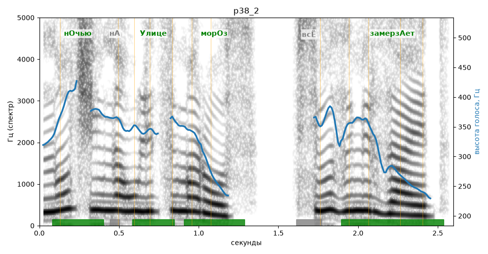

# p38_2

Голос: **Mac Milena** · длительность 2.6 с
Естественность (UTMOS): **2.6 из 5** (живой диктор ≈ 4–4.5)
Эталон: Ночью на улице мороз. Всё замерзает.
Распознано: Ночень на улице мороз, всё замерзает.
Расхождения в словах: «ночью» → «ночень»

## Ударения
(где нужно: ruaccent)

| слово | нужно | у голоса | |
|---|---|---|---|
| ночью | нОчью | нОчью | ✓ |
| улице | Улице | Улице | ✓ |
| мороз | морОз | морОз | ✓ |
| замерзает | замерзАет | замерзАет | ✓ |

## Интонация
- ✓ «ночью на улице мороз.» — конец фразы понижается — звучит законченно
- ✓ «всё замерзает.» — конец фразы понижается — звучит законченно
- Диапазон голоса 8.1 полутонов (живо), средняя высота 344 Гц

## Паузы и темп
- паузы на своих местах
- Темп 5.6 слога/с (нормально)

_Синяя линия — высота голоса. Над словами заглавная буква — где ударение должно быть; красным — голос поставил не туда (уверенно), оранжевым — возможно._
