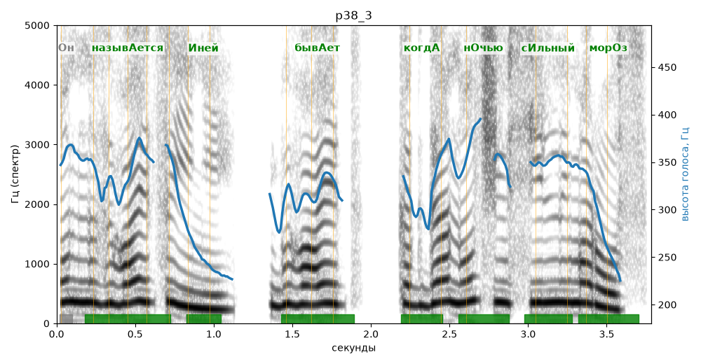

# p38_3

Голос: **Mac Milena** · длительность 3.8 с
Естественность (UTMOS): **2.75 из 5** (живой диктор ≈ 4–4.5)
Эталон: Он называется иней. Бывает, когда ночью сильный мороз.
Распознано: Он называется Иней, бывает, когда ночью сильный мороз.
Слова: все совпали

## Ударения
(где нужно: ruaccent)

| слово | нужно | у голоса | |
|---|---|---|---|
| называется | назывАется | назывАется | ✓ |
| иней | Иней | Иней | ✓ |
| бывает | бывАет | бывАет | ✓ |
| когда | когдА | когдА | ✓ |
| ночью | нОчью | нОчью | ✓ |
| сильный | сИльный | сИльный | ✓ |
| мороз | морОз | морОз | ✓ |

## Интонация
- ✓ «он называется иней.» — конец фразы понижается — звучит законченно
- ✓ «бывает когда ночью сильный мороз.» — конец фразы понижается — звучит законченно
- Диапазон голоса 7.8 полутонов (живо), средняя высота 331 Гц

## Паузы и темп
- паузы на своих местах
- Темп 6.0 слога/с (нормально)

_Синяя линия — высота голоса. Над словами заглавная буква — где ударение должно быть; красным — голос поставил не туда (уверенно), оранжевым — возможно._
