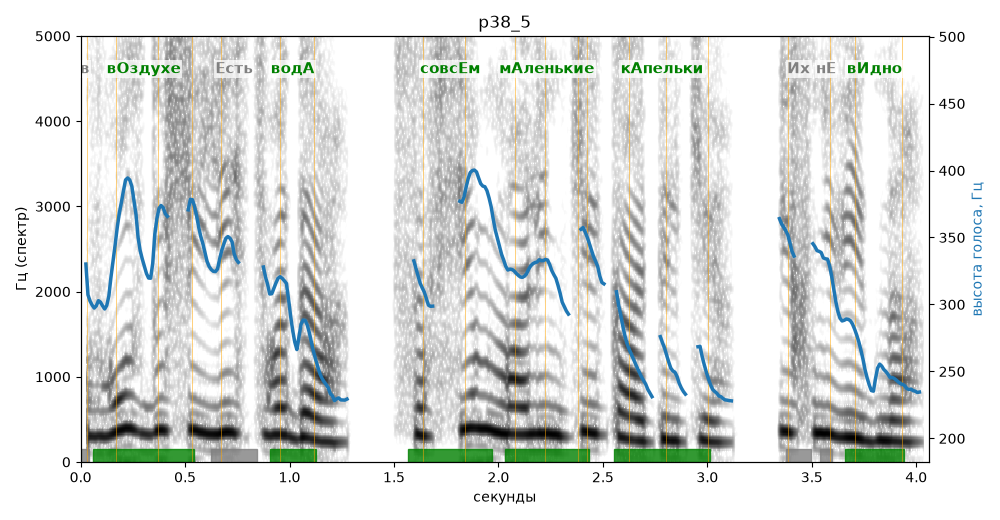

# p38_5

Голос: **Mac Milena** · длительность 4.1 с
Естественность (UTMOS): **2.47 из 5** (живой диктор ≈ 4–4.5)
Эталон: В воздухе есть вода. Совсем маленькие капельки. Их не видно.
Распознано: В воздухе есть вода, совсем маленькие капельки, их не видно.
Слова: все совпали

## Ударения
(где нужно: ruaccent)

| слово | нужно | у голоса | |
|---|---|---|---|
| воздухе | вОздухе | вОздухе | ✓ |
| вода | водА | водА | ✓ |
| совсем | совсЕм | совсЕм | ✓ |
| маленькие | мАленькие | мАленькие | ✓ |
| капельки | кАпельки | кАпельки | ✓ |
| видно | вИдно | вИдно | ✓ |

## Интонация
- ✓ «в воздухе есть вода.» — конец фразы понижается — звучит законченно
- ✓ «совсем маленькие капельки.» — конец фразы понижается — звучит законченно
- ✓ «их не видно.» — конец фразы понижается — звучит законченно
- Диапазон голоса 8.8 полутонов (живо), средняя высота 314 Гц

## Паузы и темп
- паузы на своих местах
- Темп 6.4 слога/с (нормально)

_Синяя линия — высота голоса. Над словами заглавная буква — где ударение должно быть; красным — голос поставил не туда (уверенно), оранжевым — возможно._
