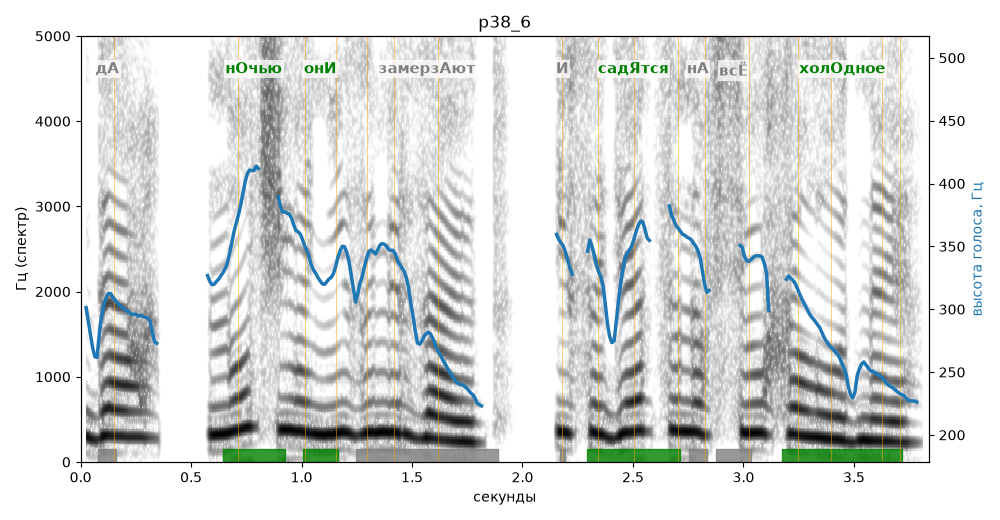

# p38_6

Голос: **Mac Milena** · длительность 3.8 с
Естественность (UTMOS): **2.5 из 5** (живой диктор ≈ 4–4.5)
Эталон: Да. Ночью они замерзают. И садятся на всё холодное.
Распознано: Да, ночью они замерзают и садятся на всё холодное.
Слова: все совпали

## Ударения
(где нужно: ruaccent)

| слово | нужно | у голоса | |
|---|---|---|---|
| ночью | нОчью | нОчью | ✓ |
| они | онИ | онИ | ✓ |
| замерзают | замерзАют | — | ? |
| садятся | садЯтся | садЯтся | ✓ |
| холодное | холОдное | холОдное | ✓ |

## Интонация
- ✓ «ночью они замерзают.» — конец фразы понижается — звучит законченно
- ✓ «и садятся на всё холодное.» — конец фразы понижается — звучит законченно
- Диапазон голоса 8.4 полутонов (живо), средняя высота 320 Гц

## Паузы и темп
- паузы на своих местах
- Темп 5.9 слога/с (нормально)

_Синяя линия — высота голоса. Над словами заглавная буква — где ударение должно быть; красным — голос поставил не туда (уверенно), оранжевым — возможно._
