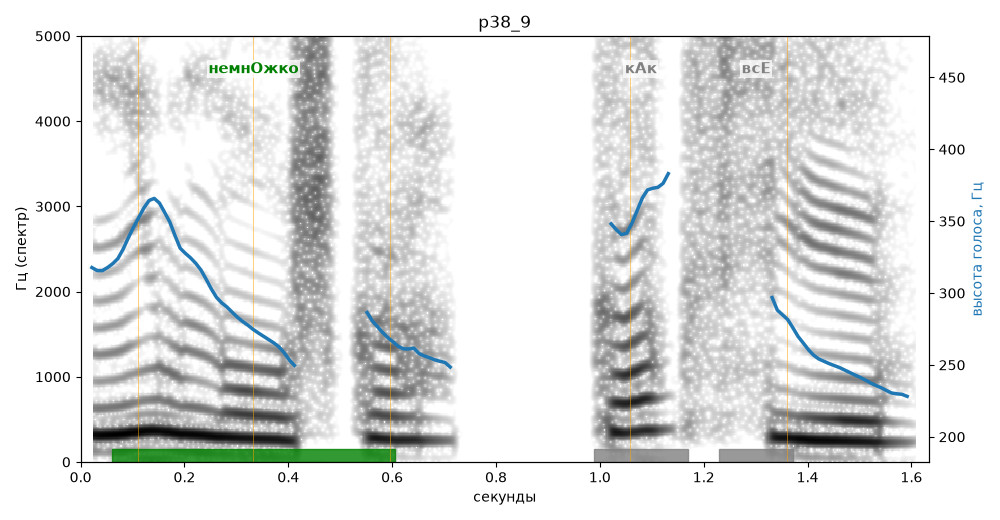

# p38_9

Голос: **Mac Milena** · длительность 1.6 с
Естественность (UTMOS): **2.65 из 5** (живой диктор ≈ 4–4.5)
Эталон: Немножко. Как все.
Распознано: Немножко, как все.
Слова: все совпали

## Ударения
(где нужно: ruaccent)

| слово | нужно | у голоса | |
|---|---|---|---|
| немножко | немнОжко | немнОжко | ✓ |

## Интонация
- ✗ «немножко.» — конец фразы не понижается — звучит незаконченно / как перечисление
- Диапазон голоса 7.8 полутонов (живо), средняя высота 279 Гц

## Паузы и темп
- паузы на своих местах
- Темп 5.4 слога/с (нормально)

_Синяя линия — высота голоса. Над словами заглавная буква — где ударение должно быть; красным — голос поставил не туда (уверенно), оранжевым — возможно._
