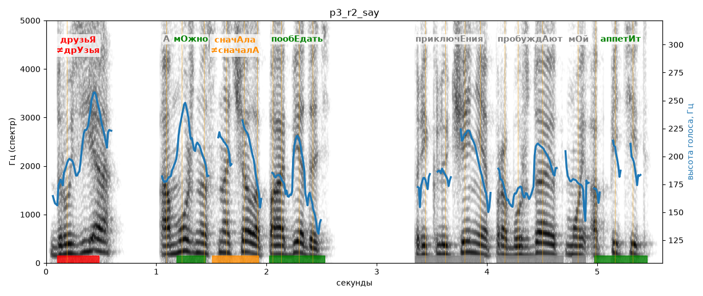

# p3_r2_say

Естественность (UTMOS): **3.03 из 5** (живой диктор ≈ 4–4.5)
Эталон: Друзья, а можно сначала пообедать? Приключения пробуждают мой аппетит!
Распознано: Друзья, а можно сначала пообедать? Приключения пробуждают мой аппетит.
Слова: все совпали

## Ударения
(где нужно: ruaccent)

| слово | нужно | у голоса | |
|---|---|---|---|
| друзья | друзьЯ | дрУзья | ✗ ОШИБКА |
| можно | мОжно | мОжно | ✓ |
| сначала | сначАла | сначалА | ✗? возможно — послушать |
| пообедать | пообЕдать | пообЕдать | ✓ |
| приключения | приключЕния | — | ? |
| пробуждают | пробуждАют | — | ? |
| аппетит | аппетИт | аппетИт | ✓ |

## Интонация
- ✗ «друзья а можно сначала пообедать?» — нет вопросительного подъёма (самое высокое место — «можно», в начале) — звучит как утверждение
- ✓ «приключения пробуждают мой аппетит!» — выделено слово «приключения» (+3.2 пт)
- Диапазон голоса 7.1 полутонов (живо), средняя высота 187 Гц

## Паузы и темп
- паузы на своих местах
- Темп 5.6 слога/с (нормально)

_Синяя линия — высота голоса. Над словами заглавная буква — где ударение должно быть; красным — голос поставил не туда (уверенно), оранжевым — возможно._
