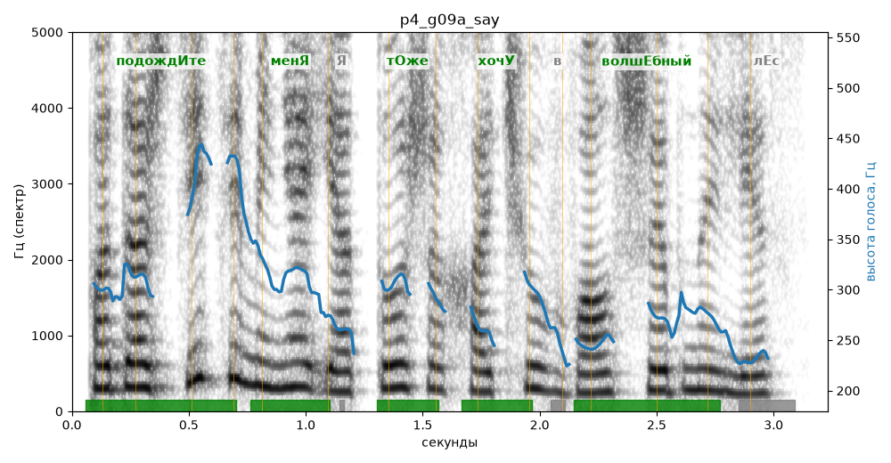

# p4_g09a_say

Естественность (UTMOS): **2.74 из 5** (живой диктор ≈ 4–4.5)
Эталон: Подождите меня! Я тоже хочу в волшебный лес!
Распознано: Подождите меня, я тоже хочу в волшебный лес.
Слова: все совпали

## Ударения
(где нужно: ruaccent)

| слово | нужно | у голоса | |
|---|---|---|---|
| подождите | подождИте | подождИте | ✓ |
| меня | менЯ | менЯ | ✓ |
| тоже | тОже | тОже | ✓ |
| хочу | хочУ | хочУ | ✓ |
| волшебный | волшЕбный | волшЕбный | ✓ |

## Интонация
- ✓ «подождите меня!» — выделено слово «подождите» (+5.4 пт)
- ✓ «я тоже хочу в волшебный лес!» — выделено слово «тоже» (+2.1 пт)
- Диапазон голоса 10.5 полутонов (живо), средняя высота 285 Гц

## Паузы и темп
- после «меня!» пауза всего 0.04 с — фразы слипаются
- Темп 5.0 слога/с (нормально)

_Синяя линия — высота голоса. Над словами заглавная буква — где ударение должно быть; красным — голос поставил не туда (уверенно), оранжевым — возможно._
