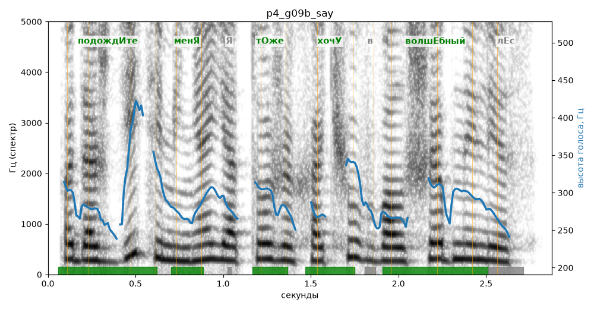

# p4_g09b_say

Естественность (UTMOS): **3.44 из 5** (живой диктор ≈ 4–4.5)
Эталон: Подождите меня! Я тоже хочу в волшебный лес!
Распознано: Подождите меня, я тоже хочу в волшебный лес.
Слова: все совпали

## Ударения
(где нужно: ruaccent)

| слово | нужно | у голоса | |
|---|---|---|---|
| подождите | подождИте | подождИте | ✓ |
| меня | менЯ | менЯ | ✓ |
| тоже | тОже | тОже | ✓ |
| хочу | хочУ | хочУ | ✓ |
| волшебный | волшЕбный | волшЕбный | ✓ |

## Интонация
- ✗ «подождите меня!» — восклицание звучит ровно, без эмоции
- ✓ «я тоже хочу в волшебный лес!» — выделено слово «хочу» (+3.6 пт)
- Диапазон голоса 5.3 полутонов (нормально), средняя высота 282 Гц

## Паузы и темп
- после «меня!» пауза всего 0.14 с — фразы слипаются
- Темп 5.7 слога/с (нормально)

_Синяя линия — высота голоса. Над словами заглавная буква — где ударение должно быть; красным — голос поставил не туда (уверенно), оранжевым — возможно._
