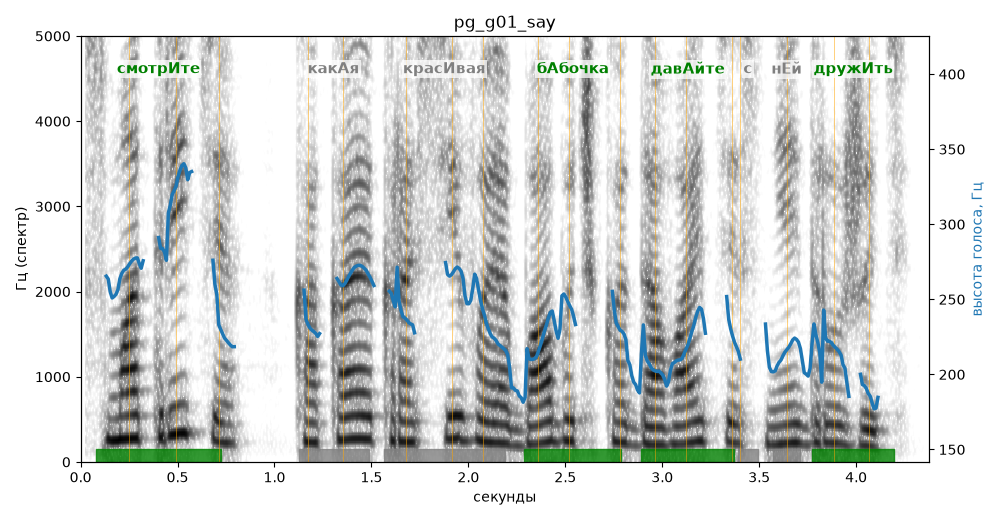

# pg_g01_say

Естественность (UTMOS): **3.62 из 5** (живой диктор ≈ 4–4.5)
Эталон: Смотрите, какая красивая бабочка! Давайте с ней дружить!
Распознано: Смотрите, какая красивая бабочка давайте с ней дружить.
Слова: все совпали

## Ударения
(где нужно: ruaccent)

| слово | нужно | у голоса | |
|---|---|---|---|
| смотрите | смотрИте | смотрИте | ✓ |
| какая | какАя | — | ? |
| красивая | красИвая | — | ? |
| бабочка | бАбочка | бАбочка | ✓ |
| давайте | давАйте | давАйте | ✓ |
| дружить | дружИть | дружИть | ✓ |

## Интонация
- ✓ «смотрите какая красивая бабочка!» — выделено слово «смотрите» (+5.1 пт)
- ✗ «давайте с ней дружить!» — восклицание звучит ровно, без эмоции
- Диапазон голоса 7.2 полутонов (живо), средняя высота 229 Гц

## Паузы и темп
- после «бабочка!» пауза всего 0.10 с — фразы слипаются
- Темп 4.8 слога/с (нормально)

_Синяя линия — высота голоса. Над словами заглавная буква — где ударение должно быть; красным — голос поставил не туда (уверенно), оранжевым — возможно._
