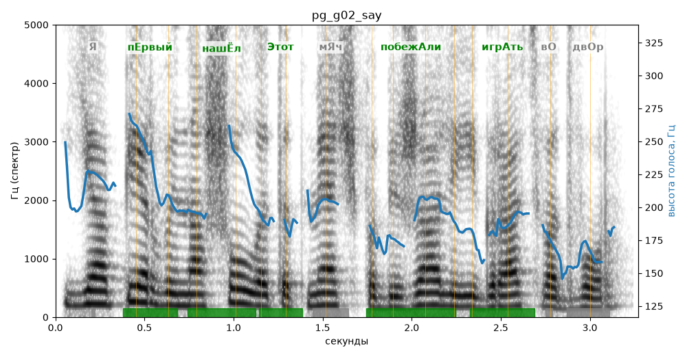

# pg_g02_say

Естественность (UTMOS): **3.46 из 5** (живой диктор ≈ 4–4.5)
Эталон: Я первый нашёл этот мяч! Побежали играть во двор!
Распознано: Я первый нашел этот мяч, побежали играть во двор.
Слова: все совпали

## Ударения
(где нужно: ruaccent)

| слово | нужно | у голоса | |
|---|---|---|---|
| первый | пЕрвый | пЕрвый | ✓ |
| нашёл | нашЁл | нашЁл | ✓ |
| этот | Этот | Этот | ✓ |
| побежали | побежАли | побежАли | ✓ |
| играть | игрАть | игрАть | ✓ |

## Интонация
- ✓ «я первый нашёл этот мяч!» — выделено слово «первый» (+4.0 пт)
- ✓ «побежали играть во двор!» — выделено слово «побежали» (+2.6 пт)
- Диапазон голоса 7.6 полутонов (живо), средняя высота 195 Гц

## Паузы и темп
- после «мяч!» пауза всего 0.10 с — фразы слипаются
- Темп 5.5 слога/с (нормально)

_Синяя линия — высота голоса. Над словами заглавная буква — где ударение должно быть; красным — голос поставил не туда (уверенно), оранжевым — возможно._
