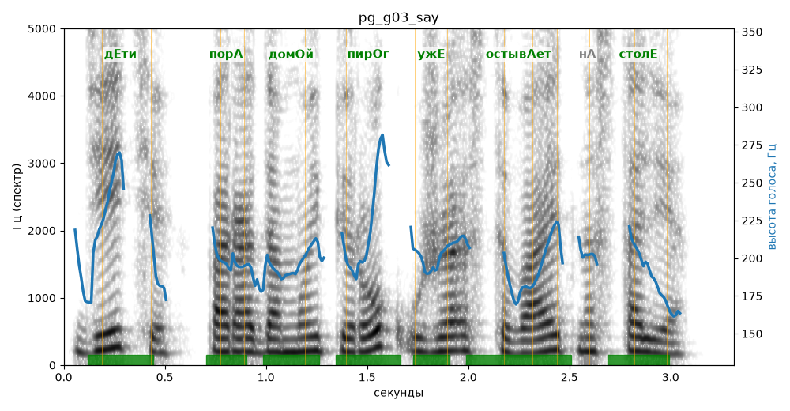

# pg_g03_say

Естественность (UTMOS): **2.98 из 5** (живой диктор ≈ 4–4.5)
Эталон: Дети, пора домой! Пирог уже остывает на столе.
Распознано: Дети, пора домой пирог уже остывает на столе.
Слова: все совпали

## Ударения
(где нужно: ruaccent)

| слово | нужно | у голоса | |
|---|---|---|---|
| дети | дЕти | дЕти | ✓ |
| пора | порА | порА | ✓ |
| домой | домОй | домОй | ✓ |
| пирог | пирОг | пирОг | ✓ |
| уже | ужЕ | ужЕ | ✓ |
| остывает | остывАет | остывАет | ✓ |
| столе | столЕ | столЕ | ✓ |

## Интонация
- ✓ «дети пора домой!» — выделено слово «дети» (+2.9 пт)
- ✓ «пирог уже остывает на столе.» — конец фразы понижается — звучит законченно
- Диапазон голоса 7.1 полутонов (живо), средняя высота 198 Гц

## Паузы и темп
- после «домой!» пауза всего 0.08 с — фразы слипаются
- Темп 6.5 слога/с (нормально)

_Синяя линия — высота голоса. Над словами заглавная буква — где ударение должно быть; красным — голос поставил не туда (уверенно), оранжевым — возможно._
