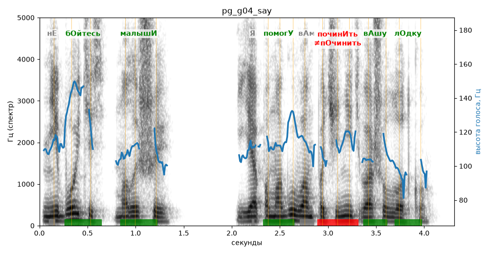

# pg_g04_say

Естественность (UTMOS): **3.58 из 5** (живой диктор ≈ 4–4.5)
Эталон: Не бойтесь, малыши. Я помогу вам починить вашу лодку.
Распознано: Не бойтесь, малыши. Я помогу вам починить вашу лодку.
Слова: все совпали

## Ударения
(где нужно: ruaccent)

| слово | нужно | у голоса | |
|---|---|---|---|
| бойтесь | бОйтесь | бОйтесь | ✓ |
| малыши | малышИ | малышИ | ✓ |
| помогу | помогУ | помогУ | ✓ |
| починить | починИть | пОчинить | ✗ ОШИБКА |
| вашу | вАшу | вАшу | ✓ |
| лодку | лОдку | лОдку | ✓ |

## Интонация
- ✓ «не бойтесь малыши.» — конец фразы понижается — звучит законченно
- ✓ «я помогу вам починить вашу лодку.» — конец фразы понижается — звучит законченно
- Диапазон голоса 6.8 полутонов (нормально), средняя высота 110 Гц

## Паузы и темп
- паузы на своих местах
- Темп 6.3 слога/с (нормально)

_Синяя линия — высота голоса. Над словами заглавная буква — где ударение должно быть; красным — голос поставил не туда (уверенно), оранжевым — возможно._
