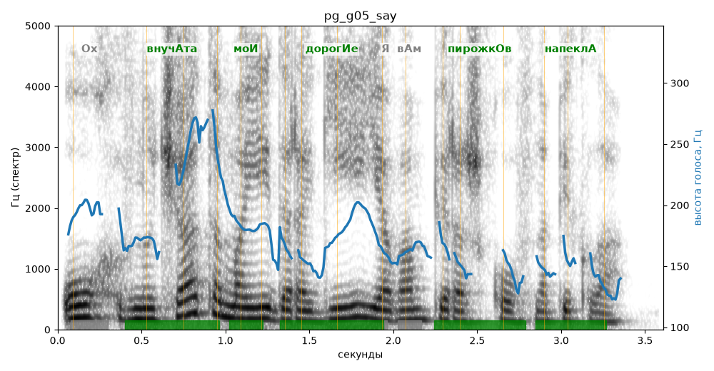

# pg_g05_say

Естественность (UTMOS): **3.52 из 5** (живой диктор ≈ 4–4.5)
Эталон: Ох, внучата мои дорогие! Я вам пирожков напекла.
Распознано: Ох, внучата мои дорогие, я вам пирожков напекла.
Слова: все совпали

## Ударения
(где нужно: ruaccent)

| слово | нужно | у голоса | |
|---|---|---|---|
| внучата | внучАта | внучАта | ✓ |
| мои | моИ | моИ | ✓ |
| дорогие | дорогИе | дорогИе | ✓ |
| пирожков | пирожкОв | пирожкОв | ✓ |
| напекла | напеклА | напеклА | ✓ |

## Интонация
- ✓ «ох внучата мои дорогие!» — выделено слово «внучата» (+5.6 пт)
- ✓ «я вам пирожков напекла.» — конец фразы понижается — звучит законченно
- Диапазон голоса 10.5 полутонов (живо), средняя высота 169 Гц

## Паузы и темп
- после «дорогие!» пауза всего 0.00 с — фразы слипаются
- Темп 5.3 слога/с (нормально)

_Синяя линия — высота голоса. Над словами заглавная буква — где ударение должно быть; красным — голос поставил не туда (уверенно), оранжевым — возможно._
