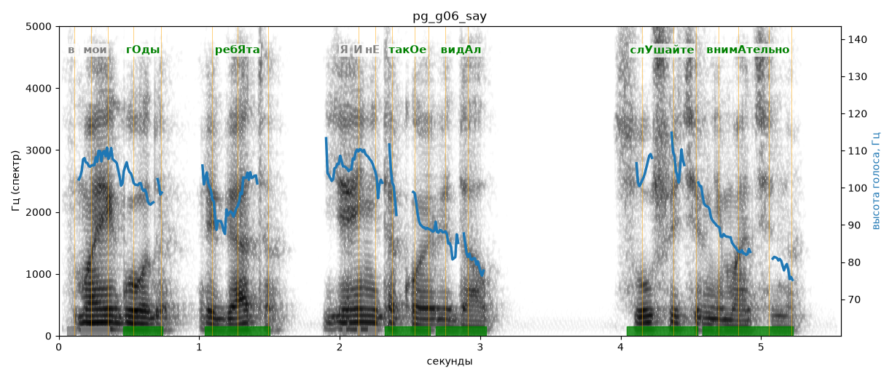

# pg_g06_say

Естественность (UTMOS): **2.47 из 5** (живой диктор ≈ 4–4.5)
Эталон: В мои годы, ребята, я и не такое видал. Слушайте внимательно.
Распознано: В мои годы, ребята, я и не такое видал. Слушайте внимательно.
Слова: все совпали

## Ударения
(где нужно: ruaccent)

| слово | нужно | у голоса | |
|---|---|---|---|
| мои | мои | моИ | нет эталона |
| годы | гОды | гОды | ✓ |
| ребята | ребЯта | ребЯта | ✓ |
| такое | такОе | такОе | ✓ |
| видал | видАл | видАл | ✓ |
| слушайте | слУшайте | слУшайте | ✓ |
| внимательно | внимАтельно | внимАтельно | ✓ |

## Интонация
- ✓ «в мои годы ребята я и не такое видал.» — конец фразы понижается — звучит законченно
- ✓ «слушайте внимательно.» — конец фразы понижается — звучит законченно
- Диапазон голоса 5.4 полутонов (нормально), средняя высота 100 Гц

## Паузы и темп
- паузы на своих местах
- Темп 6.6 слога/с (быстро)

_Синяя линия — высота голоса. Над словами заглавная буква — где ударение должно быть; красным — голос поставил не туда (уверенно), оранжевым — возможно._
