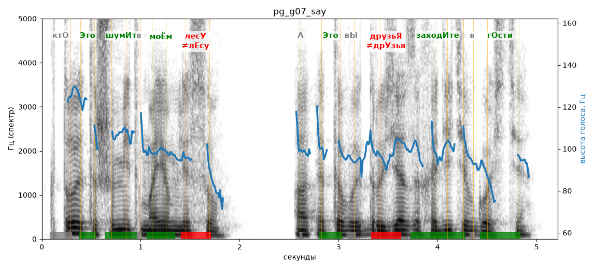

# pg_g07_say

Естественность (UTMOS): **3.15 из 5** (живой диктор ≈ 4–4.5)
Эталон: Кто это шумит в моём лесу? А, это вы, друзья! Заходите в гости.
Распознано: Кто это шумит в моем лесу? А это вы, друзья, заходите в гости.
Слова: все совпали

## Ударения
(где нужно: ruaccent)

| слово | нужно | у голоса | |
|---|---|---|---|
| это | Это | Это | ✓ |
| шумит | шумИт | шумИт | ✓ |
| моём | моЁм | моЁм | ✓ |
| лесу | лесУ | лЕсу | ✗ ОШИБКА |
| это | Это | Это | ✓ |
| друзья | друзьЯ | дрУзья | ✗ ОШИБКА |
| заходите | заходИте | заходИте | ✓ |
| гости | гОсти | гОсти | ✓ |

## Интонация
- ✓ «кто это шумит в моём лесу?» — конец фразы понижается — звучит законченно
- ✗ «а это вы друзья!» — восклицание звучит ровно, без эмоции
- ✓ «заходите в гости.» — конец фразы понижается — звучит законченно
- Диапазон голоса 6.8 полутонов (нормально), средняя высота 98 Гц

## Паузы и темп
- после «друзья!» пауза всего 0.10 с — фразы слипаются
- Темп 6.3 слога/с (нормально)

_Синяя линия — высота голоса. Над словами заглавная буква — где ударение должно быть; красным — голос поставил не туда (уверенно), оранжевым — возможно._
