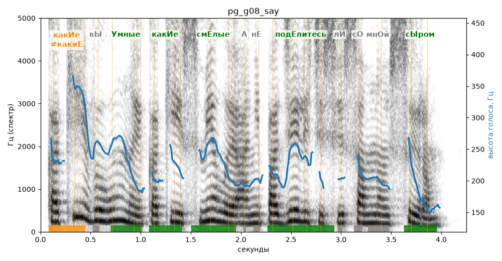

# pg_g08_say

Естественность (UTMOS): **3.19 из 5** (живой диктор ≈ 4–4.5)
Эталон: Какие вы умные, какие смелые! А не поделитесь ли со мной сыром?
Распознано: Какие вы умные, какие смелые, а не поделитесь ли со мной сыром?
Слова: все совпали

## Ударения
(где нужно: ruaccent)

| слово | нужно | у голоса | |
|---|---|---|---|
| какие | какИе | какиЕ | ✗? возможно — послушать |
| умные | Умные | Умные | ✓ |
| какие | какИе | какИе | ✓ |
| смелые | смЕлые | смЕлые | ✓ |
| поделитесь | подЕлитесь | подЕлитесь | ✓ |
| сыром | сЫром | сЫром | ✓ |

## Интонация
- ✓ «какие вы умные какие смелые!» — выделено слово «какие» (+7.1 пт)
- ✓ «а не поделитесь ли со мной сыром?» — вопросительный подъём на слове «поделитесь»
- Диапазон голоса 9.1 полутонов (живо), средняя высота 214 Гц

## Паузы и темп
- после «смелые!» пауза всего 0.08 с — фразы слипаются
- Темп 6.5 слога/с (нормально)

_Синяя линия — высота голоса. Над словами заглавная буква — где ударение должно быть; красным — голос поставил не туда (уверенно), оранжевым — возможно._
