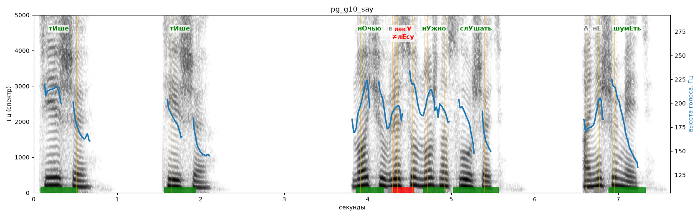

# pg_g10_say

Естественность (UTMOS): **3.42 из 5** (живой диктор ≈ 4–4.5)
Эталон: Тише, тише. Ночью в лесу нужно слушать, а не шуметь.
Распознано: Тише, тише. Ночью в лесу нужно слушать, а не шуметь.
Слова: все совпали

## Ударения
(где нужно: ruaccent)

| слово | нужно | у голоса | |
|---|---|---|---|
| тише | тИше | тИше | ✓ |
| тише | тИше | тИше | ✓ |
| ночью | нОчью | нОчью | ✓ |
| лесу | лесУ | лЕсу | ✗ ОШИБКА |
| нужно | нУжно | нУжно | ✓ |
| слушать | слУшать | слУшать | ✓ |
| шуметь | шумЕть | шумЕть | ✓ |

## Интонация
- ✗ «тише тише.» — конец фразы не понижается — звучит незаконченно / как перечисление
- ✓ «ночью в лесу нужно слушать а не шуметь.» — конец фразы понижается — звучит законченно
- Диапазон голоса 6.9 полутонов (нормально), средняя высота 188 Гц

## Паузы и темп
- паузы на своих местах
- Темп 4.9 слога/с (нормально)

_Синяя линия — высота голоса. Над словами заглавная буква — где ударение должно быть; красным — голос поставил не туда (уверенно), оранжевым — возможно._
