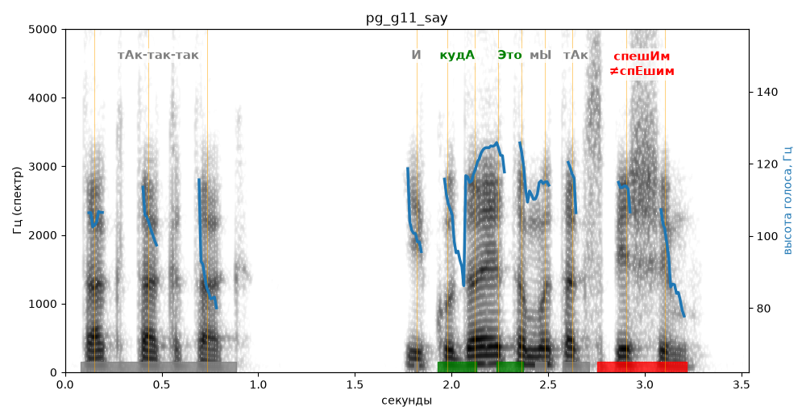

# pg_g11_say

Естественность (UTMOS): **3.28 из 5** (живой диктор ≈ 4–4.5)
Эталон: Так-так-так. И куда это мы так спешим?
Распознано: Так, так, так. И куда это мы так спешим?
Расхождения в словах: «так-так-так» → «так так так»

## Ударения
(где нужно: ruaccent)

| слово | нужно | у голоса | |
|---|---|---|---|
| так-так-так | тАк-так-так | так-так-тАк | ? не разобрать |
| куда | кудА | кудА | ✓ |
| это | Это | Это | ✓ |
| спешим | спешИм | спЕшим | ✗ ОШИБКА |

## Интонация
- ✗ «так-так-так.» — конец фразы не понижается — звучит незаконченно / как перечисление
- ✗ «и куда это мы так спешим?» — нет вопросительного подъёма (самое высокое место — «это», в начале) — звучит как утверждение
- Диапазон голоса 7.0 полутонов (живо), средняя высота 107 Гц

## Паузы и темп
- паузы на своих местах
- Темп 5.4 слога/с (нормально)

_Синяя линия — высота голоса. Над словами заглавная буква — где ударение должно быть; красным — голос поставил не туда (уверенно), оранжевым — возможно._
