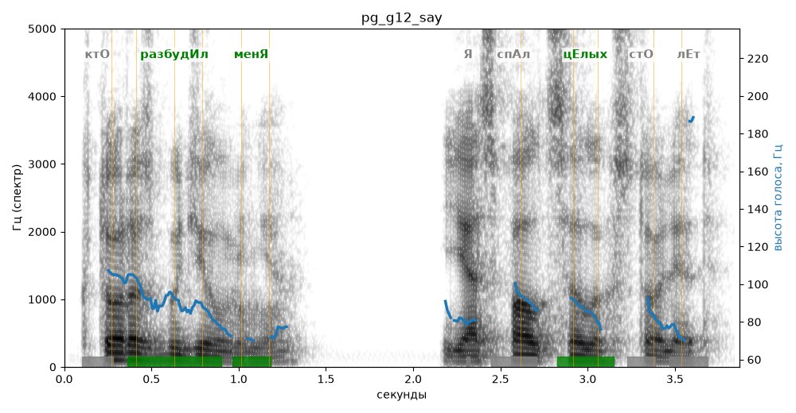

# pg_g12_say

Естественность (UTMOS): **2.98 из 5** (живой диктор ≈ 4–4.5)
Эталон: Кто разбудил меня? Я спал целых сто лет!
Распознано: Кто разбудил меня? Я спал целых сто лет.
Слова: все совпали

## Ударения
(где нужно: ruaccent)

| слово | нужно | у голоса | |
|---|---|---|---|
| разбудил | разбудИл | разбудИл | ✓ |
| меня | менЯ | менЯ | ✓ |
| целых | цЕлых | цЕлых | ✓ |

## Интонация
- ✓ «кто разбудил меня?» — конец фразы понижается — звучит законченно
- ✗ «я спал целых сто лет!» — восклицание звучит ровно, без эмоции
- Диапазон голоса 6.7 полутонов (нормально), средняя высота 86 Гц

## Паузы и темп
- паузы на своих местах
- Темп 4.5 слога/с (нормально)

_Синяя линия — высота голоса. Над словами заглавная буква — где ударение должно быть; красным — голос поставил не туда (уверенно), оранжевым — возможно._
