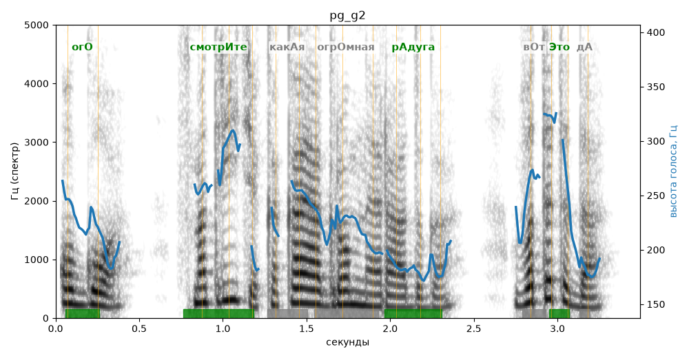

# pg_g2

Естественность (UTMOS): **3.41 из 5** (живой диктор ≈ 4–4.5)
Эталон: Ого! Смотрите, какая огромная радуга! Вот это да!
Распознано: Ого, смотрите, какая огромная радуга. Вот это да.
Слова: все совпали

## Ударения
(где нужно: ruaccent)

| слово | нужно | у голоса | |
|---|---|---|---|
| ого | огО | огО | ✓ |
| смотрите | смотрИте | смотрИте | ✓ |
| какая | какАя | — | ? |
| огромная | огрОмная | — | ? |
| радуга | рАдуга | рАдуга | ✓ |
| это | Это | Это | ✓ |

## Интонация
- ✓ «смотрите какая огромная радуга!» — выделено слово «смотрите» (+5.3 пт)
- ✓ «вот это да!» — выделено слово «это» (+5.0 пт)
- Диапазон голоса 9.5 полутонов (живо), средняя высота 219 Гц

## Паузы и темп
- паузы на своих местах
- Темп 7.9 слога/с (быстро)

_Синяя линия — высота голоса. Над словами заглавная буква — где ударение должно быть; красным — голос поставил не туда (уверенно), оранжевым — возможно._
