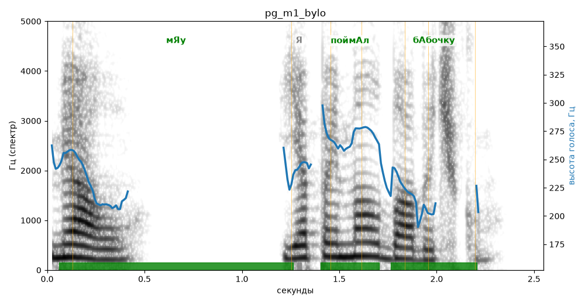

# pg_m1_bylo

Естественность (UTMOS): **3.19 из 5** (живой диктор ≈ 4–4.5)
Эталон: Мяу! Я поймал бабочку!
Распознано: Мяу, я поймал бабочку.
Слова: все совпали

## Ударения
(где нужно: ruaccent)

| слово | нужно | у голоса | |
|---|---|---|---|
| мяу | мЯу | мЯу | ✓ |
| поймал | поймАл | поймАл | ✓ |
| бабочку | бАбочку | бАбочку | ✓ |

## Интонация
- ✓ «я поймал бабочку!» — выделено слово «поймал» (+3.4 пт)
- Диапазон голоса 5.5 полутонов (нормально), средняя высота 242 Гц

## Паузы и темп
- после «мяу!» пауза всего 0.02 с — фразы слипаются
- Темп 3.3 слога/с (медленно)

_Синяя линия — высота голоса. Над словами заглавная буква — где ударение должно быть; красным — голос поставил не туда (уверенно), оранжевым — возможно._
