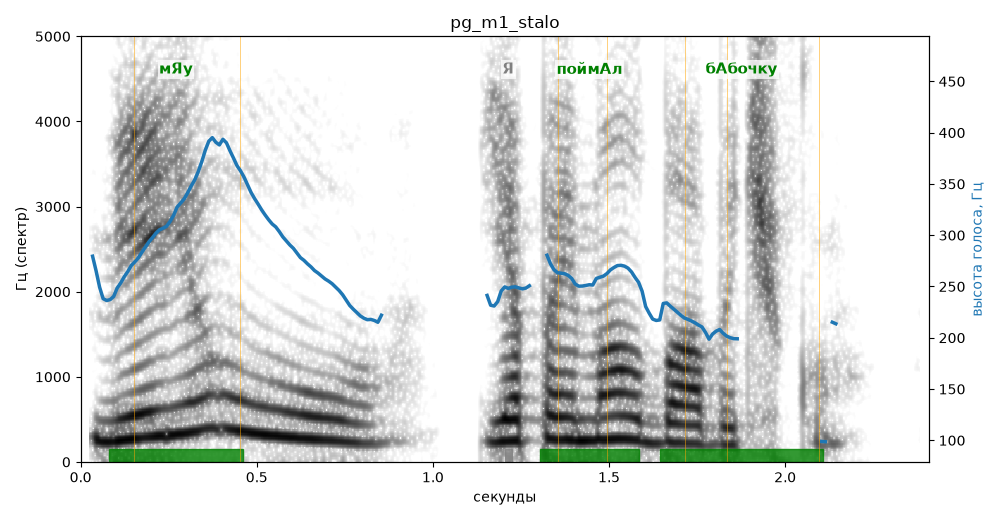

# pg_m1_stalo

Естественность (UTMOS): **3.55 из 5** (живой диктор ≈ 4–4.5)
Эталон: Мяу! Я поймал бабочку!
Распознано: Мею! Я поймал бабочку.
Расхождения в словах: «мяу» → «мею»

## Ударения
(где нужно: ruaccent)

| слово | нужно | у голоса | |
|---|---|---|---|
| мяу | мЯу | мЯу | ✓ |
| поймал | поймАл | поймАл | ✓ |
| бабочку | бАбочку | бАбочку | ✓ |

## Интонация
- ✓ «я поймал бабочку!» — выделено слово «поймал» (+3.0 пт)
- Диапазон голоса 10.6 полутонов (живо), средняя высота 258 Гц

## Паузы и темп
- паузы на своих местах
- Темп 5.5 слога/с (нормально)

_Синяя линия — высота голоса. Над словами заглавная буква — где ударение должно быть; красным — голос поставил не туда (уверенно), оранжевым — возможно._
