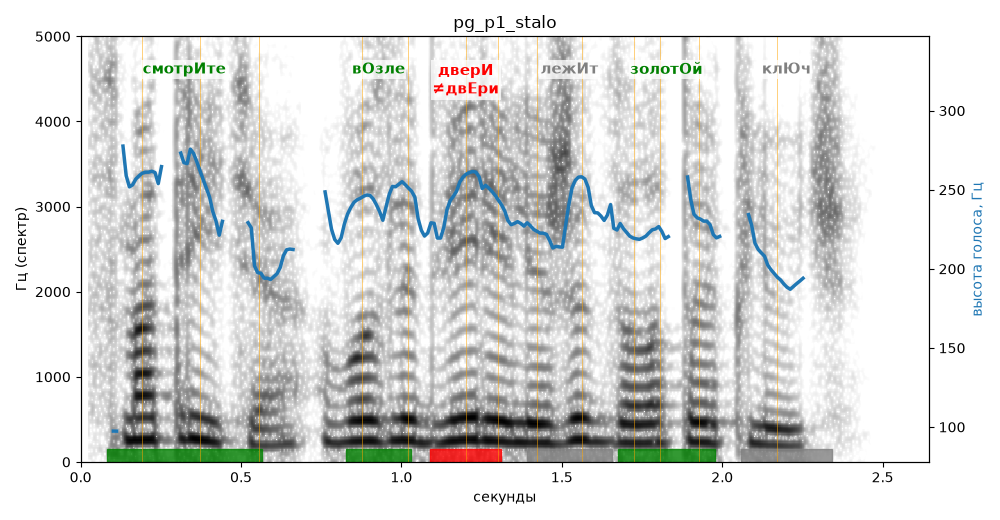

# pg_p1_stalo

Естественность (UTMOS): **2.81 из 5** (живой диктор ≈ 4–4.5)
Эталон: Смотрите, возле двери лежит золотой ключ!
Распознано: Смотрите, возле двери лежит золотой ключ.
Слова: все совпали

## Ударения
(где нужно: ruaccent)

| слово | нужно | у голоса | |
|---|---|---|---|
| смотрите | смотрИте | смотрИте | ✓ |
| возле | вОзле | вОзле | ✓ |
| двери | дверИ | двЕри | ✗ ОШИБКА |
| лежит | лежИт | лЕжит | ? не разобрать |
| золотой | золотОй | золотОй | ✓ |

## Интонация
- ✗ «смотрите возле двери лежит золотой ключ!» — восклицание звучит ровно, без эмоции
- Диапазон голоса 5.2 полутонов (нормально), средняя высота 230 Гц

## Паузы и темп
- паузы на своих местах
- Темп 6.5 слога/с (нормально)

_Синяя линия — высота голоса. Над словами заглавная буква — где ударение должно быть; красным — голос поставил не туда (уверенно), оранжевым — возможно._
