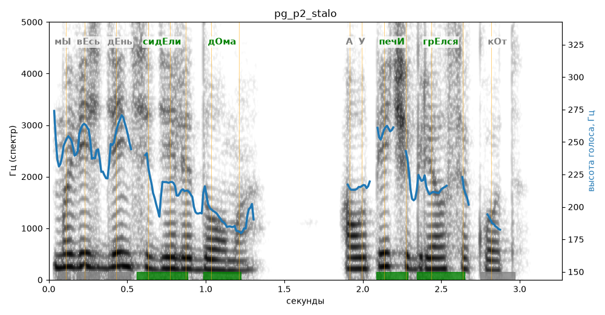

# pg_p2_stalo

Естественность (UTMOS): **3.43 из 5** (живой диктор ≈ 4–4.5)
Эталон: Мы весь день сидели дома, а у печи грелся кот.
Распознано: Мы весь день сидели дома, а у печи грелся кот.
Слова: все совпали

## Ударения
(где нужно: ruaccent)

| слово | нужно | у голоса | |
|---|---|---|---|
| сидели | сидЕли | сидЕли | ✓ |
| дома | дОма | дОма | ✓ |
| печи | печИ | печИ | ✓ |
| грелся | грЕлся | грЕлся | ✓ |

## Интонация
- ✓ «мы весь день сидели дома а у печи грелся кот.» — конец фразы понижается — звучит законченно
- Диапазон голоса 6.1 полутонов (нормально), средняя высота 215 Гц

## Паузы и темп
- паузы на своих местах
- Темп 6.7 слога/с (быстро)

_Синяя линия — высота голоса. Над словами заглавная буква — где ударение должно быть; красным — голос поставил не туда (уверенно), оранжевым — возможно._
