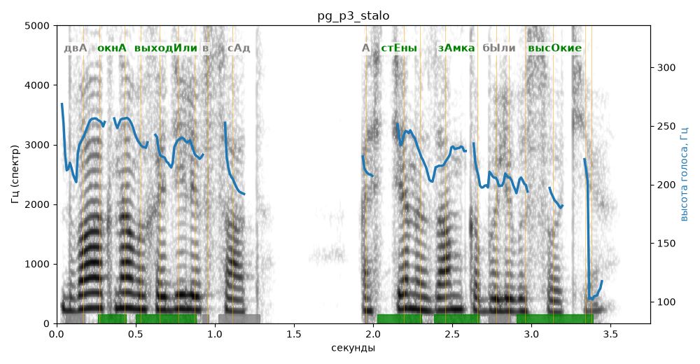

# pg_p3_stalo

Естественность (UTMOS): **3.66 из 5** (живой диктор ≈ 4–4.5)
Эталон: Два окна выходили в сад, а стены замка были высокие.
Распознано: Два окна выходили в сад, а стены замка были высокие.
Слова: все совпали

## Ударения
(где нужно: ruaccent)

| слово | нужно | у голоса | |
|---|---|---|---|
| окна | окнА | окнА | ✓ |
| выходили | выходИли | выходИли | ✓ |
| стены | стЕны | стЕны | ✓ |
| замка | зАмка | зАмка | ✓ |
| были | бЫли | былИ | ? не разобрать |
| высокие | высОкие | высОкие | ✓ |

## Интонация
- ✓ «два окна выходили в сад а стены замка были высокие.» — конец фразы понижается — звучит законченно
- Диапазон голоса 5.9 полутонов (нормально), средняя высота 222 Гц

## Паузы и темп
- паузы на своих местах
- Темп 7.5 слога/с (быстро)

_Синяя линия — высота голоса. Над словами заглавная буква — где ударение должно быть; красным — голос поставил не туда (уверенно), оранжевым — возможно._
