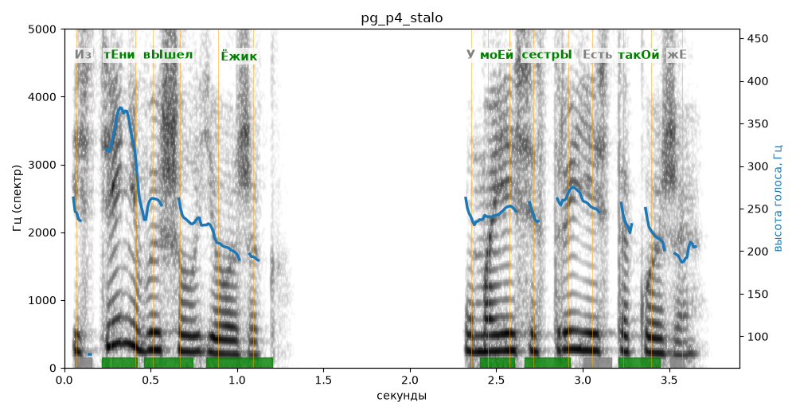

# pg_p4_stalo

Естественность (UTMOS): **3.91 из 5** (живой диктор ≈ 4–4.5)
Эталон: Из тени вышел ёжик. У моей сестры есть такой же!
Распознано: И с тени вышел ежик. У моей сестры есть такое же.
Расхождения в словах: «из» → «и с»; «такой» → «такое»

## Ударения
(где нужно: ruaccent)

| слово | нужно | у голоса | |
|---|---|---|---|
| тени | тЕни | тЕни | ✓ |
| вышел | вЫшел | вЫшел | ✓ |
| ёжик | Ёжик | Ёжик | ✓ |
| моей | моЕй | моЕй | ✓ |
| сестры | сестрЫ | сестрЫ | ✓ |
| такой | такОй | такОй | ✓ |

## Интонация
- ✓ «из тени вышел ёжик.» — конец фразы понижается — звучит законченно
- ✗ «у моей сестры есть такой же!» — восклицание звучит ровно, без эмоции
- Диапазон голоса 10.1 полутонов (живо), средняя высота 240 Гц

## Паузы и темп
- паузы на своих местах
- Темп 6.7 слога/с (быстро)

_Синяя линия — высота голоса. Над словами заглавная буква — где ударение должно быть; красным — голос поставил не туда (уверенно), оранжевым — возможно._
