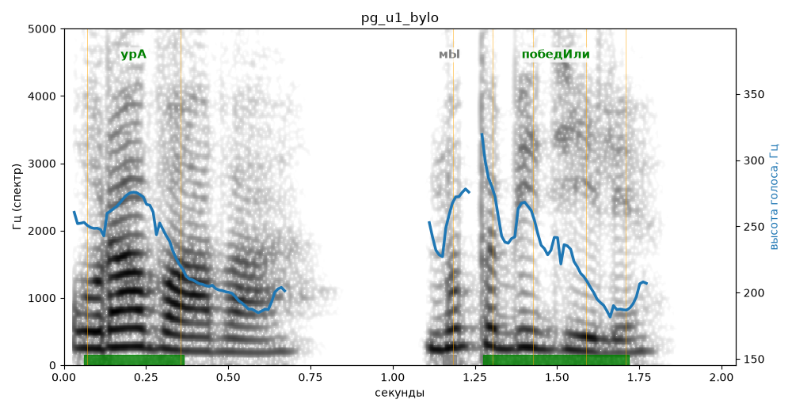

# pg_u1_bylo

Естественность (UTMOS): **3.36 из 5** (живой диктор ≈ 4–4.5)
Эталон: Ура! Мы победили!
Распознано: Ура-ва-ва! Мы победили!
Расхождения в словах: «ура» → «ура-ва-ва»

## Ударения
(где нужно: ruaccent)

| слово | нужно | у голоса | |
|---|---|---|---|
| ура | урА | урА | ✓ |
| победили | победИли | победИли | ✓ |

## Интонация
- ✗ «мы победили!» — восклицание звучит ровно, без эмоции
- Диапазон голоса 6.7 полутонов (нормально), средняя высота 233 Гц

## Паузы и темп
- паузы на своих местах
- Темп 8.0 слога/с (быстро)

_Синяя линия — высота голоса. Над словами заглавная буква — где ударение должно быть; красным — голос поставил не туда (уверенно), оранжевым — возможно._
