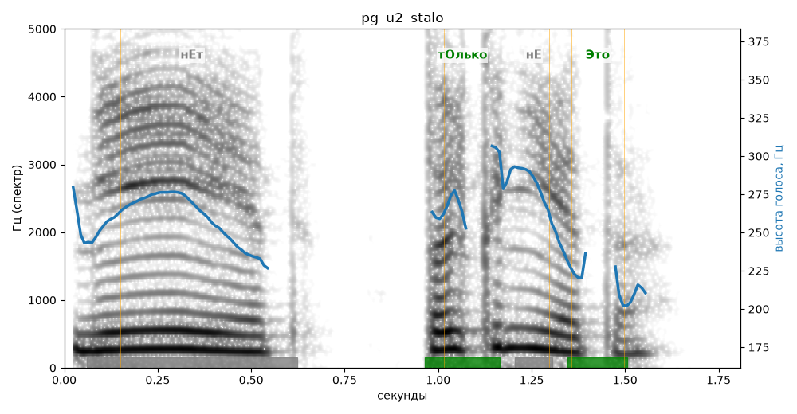

# pg_u2_stalo

Естественность (UTMOS): **3.39 из 5** (живой диктор ≈ 4–4.5)
Эталон: Нет! Только не это!
Распознано: Нет, только нет.
Расхождения в словах: «не это» → «нет»

## Ударения
(где нужно: ruaccent)

| слово | нужно | у голоса | |
|---|---|---|---|
| только | тОлько | тОлько | ✓ |
| это | Это | Это | ✓ |

## Интонация
- ✗ «только не это!» — восклицание звучит ровно, без эмоции
- Диапазон голоса 5.7 полутонов (нормально), средняя высота 261 Гц

## Паузы и темп
- паузы на своих местах
- Темп 5.4 слога/с (нормально)

_Синяя линия — высота голоса. Над словами заглавная буква — где ударение должно быть; красным — голос поставил не туда (уверенно), оранжевым — возможно._
