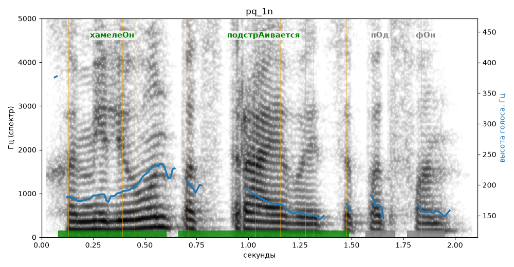

# pq_1n

Голос: **Альбина, вопрос (подъём: нет)** · длительность 2.1 с
Естественность (UTMOS): **3.62 из 5** (живой диктор ≈ 4–4.5)
Эталон: Хамелеон подстраивается под фон?
Распознано: Хамелеон подстраивается под фан.
Расхождения в словах: «фон» → «фан»

## Ударения
(где нужно: ruaccent)

| слово | нужно | у голоса | |
|---|---|---|---|
| хамелеон | хамелеОн | хамелеОн | ✓ |
| подстраивается | подстрАивается | подстрАивается | ✓ |

## Интонация
- ✗ «хамелеон подстраивается под фон?» — нет вопросительного подъёма (самое высокое место — «хамелеон», в начале) — звучит как утверждение
- Диапазон голоса 7.5 полутонов (живо), средняя высота 177 Гц

## Паузы и темп
- паузы на своих местах
- Темп 6.4 слога/с (нормально)

_Синяя линия — высота голоса. Над словами заглавная буква — где ударение должно быть; красным — голос поставил не туда (уверенно), оранжевым — возможно._
