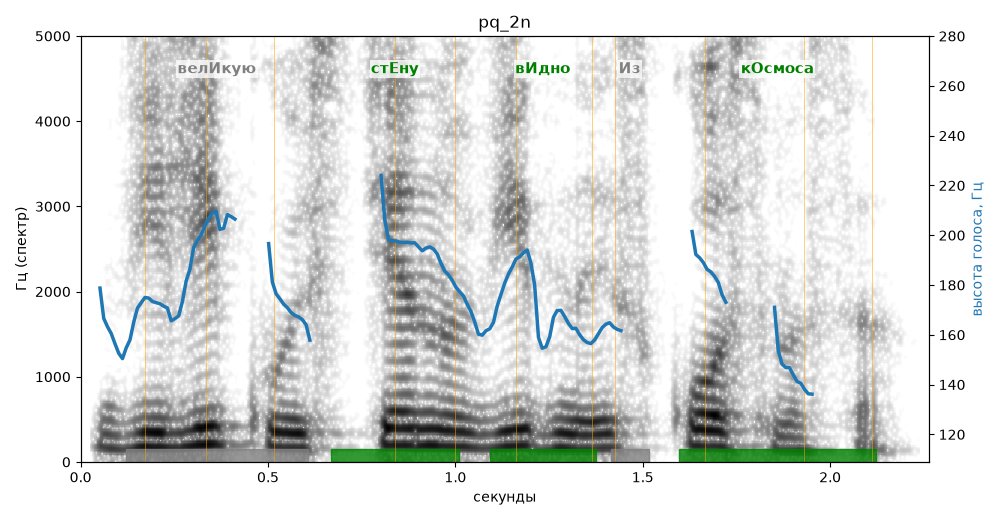

# pq_2n

Голос: **Альбина, вопрос (подъём: нет)** · длительность 2.3 с
Естественность (UTMOS): **3.52 из 5** (живой диктор ≈ 4–4.5)
Эталон: Великую стену видно из космоса?
Распознано: Великую стену видно из космоса.
Слова: все совпали

## Ударения
(где нужно: ruaccent)

| слово | нужно | у голоса | |
|---|---|---|---|
| великую | велИкую | — | ? |
| стену | стЕну | стЕну | ✓ |
| видно | вИдно | вИдно | ✓ |
| космоса | кОсмоса | кОсмоса | ✓ |

## Интонация
- ✗ «великую стену видно из космоса?» — нет вопросительного подъёма (самое высокое место — «великую», в начале) — звучит как утверждение
- Диапазон голоса 5.9 полутонов (нормально), средняя высота 173 Гц

## Паузы и темп
- паузы на своих местах
- Темп 5.5 слога/с (нормально)

_Синяя линия — высота голоса. Над словами заглавная буква — где ударение должно быть; красным — голос поставил не туда (уверенно), оранжевым — возможно._
