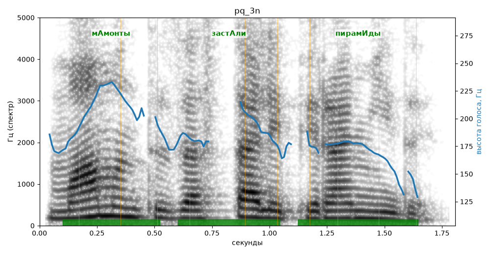

# pq_3n

Голос: **Альбина, вопрос (подъём: нет)** · длительность 1.8 с
Естественность (UTMOS): **3.39 из 5** (живой диктор ≈ 4–4.5)
Эталон: Мамонты застали пирамиды?
Распознано: Мамонт и застали пирамиды.
Расхождения в словах: «мамонты» → «мамонт и»

## Ударения
(где нужно: ruaccent)

| слово | нужно | у голоса | |
|---|---|---|---|
| мамонты | мАмонты | мАмонты | ✓ |
| застали | застАли | застАли | ✓ |
| пирамиды | пирамИды | пирамИды | ✓ |

## Интонация
- ✗ «мамонты застали пирамиды?» — нет вопросительного подъёма (самое высокое место — «застали», в начале) — звучит как утверждение
- Диапазон голоса 7.4 полутонов (живо), средняя высота 179 Гц

## Паузы и темп
- паузы на своих местах
- Темп 6.5 слога/с (нормально)

_Синяя линия — высота голоса. Над словами заглавная буква — где ударение должно быть; красным — голос поставил не туда (уверенно), оранжевым — возможно._
