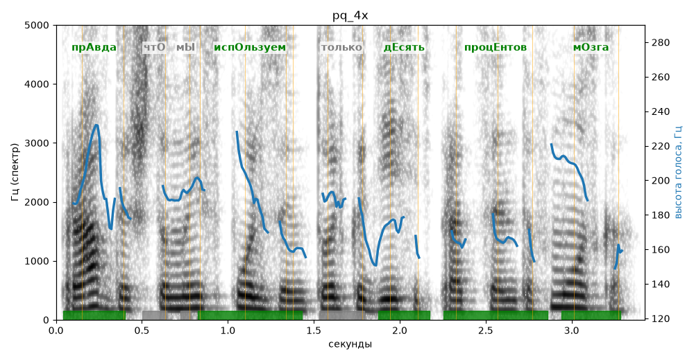

# pq_4x

Голос: **Альбина, вопрос (подъём: x-high)** · длительность 3.4 с
Естественность (UTMOS): **3.14 из 5** (живой диктор ≈ 4–4.5)
Эталон: Правда, что мы используем только десять процентов мозга?
Распознано: Правда, что мы используем только 10% мозга.
Расхождения в словах: «десять процентов» → «10»

## Ударения
(где нужно: ruaccent)

| слово | нужно | у голоса | |
|---|---|---|---|
| правда | прАвда | прАвда | ✓ |
| используем | испОльзуем | испОльзуем | ✓ |
| только | только | тОлько | нет эталона |
| десять | дЕсять | дЕсять | ✓ |
| процентов | процЕнтов | процЕнтов | ✓ |
| мозга | мОзга | мОзга | ✓ |

## Интонация
- ✓ «правда что мы используем только десять процентов мозга?» — вопросительный подъём на слове «мозга»
- Диапазон голоса 5.6 полутонов (нормально), средняя высота 185 Гц

## Паузы и темп
- паузы на своих местах
- Темп 5.2 слога/с (нормально)

_Синяя линия — высота голоса. Над словами заглавная буква — где ударение должно быть; красным — голос поставил не туда (уверенно), оранжевым — возможно._
