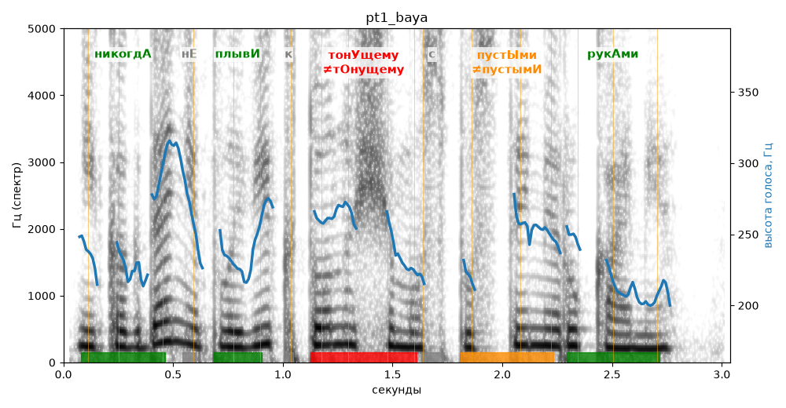

# pt1_baya

Голос: **silero:baya** · длительность 3.0 с
Естественность (UTMOS): **3.03 из 5** (живой диктор ≈ 4–4.5)
Эталон: Никогда не плыви к тонущему с пустыми руками.
Распознано: Никогда не плыви к тонущему с пустыми руками.
Слова: все совпали

## Ударения
(где нужно: ruaccent)

| слово | нужно | у голоса | |
|---|---|---|---|
| никогда | никогдА | никогдА | ✓ |
| плыви | плывИ | плывИ | ✓ |
| тонущему | тонУщему | тОнущему | ✗ ОШИБКА |
| пустыми | пустЫми | пустымИ | ✗? возможно — послушать |
| руками | рукАми | рукАми | ✓ |

## Интонация
- ✓ «никогда не плыви к тонущему с пустыми руками.» — конец фразы понижается — звучит законченно
- Диапазон голоса 6.4 полутонов (нормально), средняя высота 239 Гц

## Паузы и темп
- паузы на своих местах
- Темп 6.8 слога/с (быстро)

_Синяя линия — высота голоса. Над словами заглавная буква — где ударение должно быть; красным — голос поставил не туда (уверенно), оранжевым — возможно._
