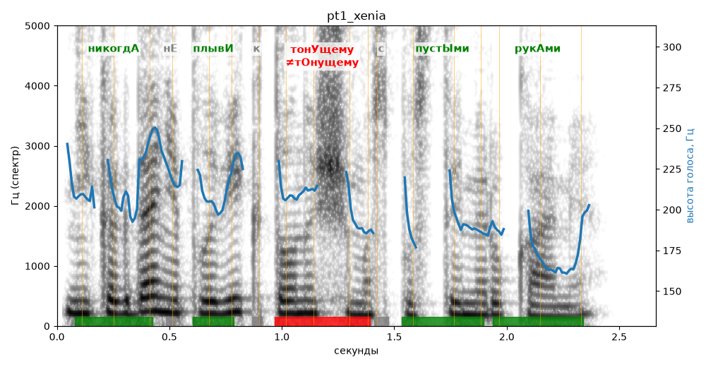

# pt1_xenia

Голос: **silero:xenia** · длительность 2.7 с
Естественность (UTMOS): **3.47 из 5** (живой диктор ≈ 4–4.5)
Эталон: Никогда не плыви к тонущему с пустыми руками.
Распознано: никогда не плыви к тонущему с пустыми руками.
Слова: все совпали

## Ударения
(где нужно: ruaccent)

| слово | нужно | у голоса | |
|---|---|---|---|
| никогда | никогдА | никогдА | ✓ |
| плыви | плывИ | плывИ | ✓ |
| тонущему | тонУщему | тОнущему | ✗ ОШИБКА |
| пустыми | пустЫми | пустЫми | ✓ |
| руками | рукАми | рукАми | ✓ |

## Интонация
- ✓ «никогда не плыви к тонущему с пустыми руками.» — конец фразы понижается — звучит законченно
- Диапазон голоса 6.3 полутонов (нормально), средняя высота 203 Гц

## Паузы и темп
- паузы на своих местах
- Темп 8.0 слога/с (быстро)

_Синяя линия — высота голоса. Над словами заглавная буква — где ударение должно быть; красным — голос поставил не туда (уверенно), оранжевым — возможно._
