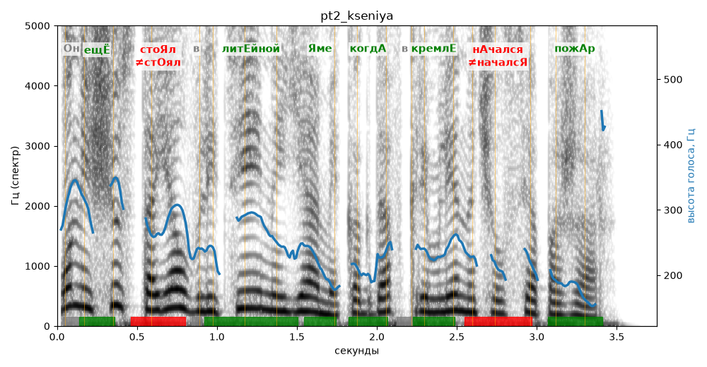

# pt2_kseniya

Голос: **silero:kseniya** · длительность 3.8 с
Естественность (UTMOS): **3.53 из 5** (живой диктор ≈ 4–4.5)
Эталон: Он ещё стоял в литейной яме, когда в Кремле начался пожар.
Распознано: Он еще стоял в летейной яме, когда в Кремле начался пожар.
Расхождения в словах: «литейной» → «летейной»

## Ударения
(где нужно: ruaccent)

| слово | нужно | у голоса | |
|---|---|---|---|
| ещё | ещЁ | ещЁ | ✓ |
| стоял | стоЯл | стОял | ✗ ОШИБКА |
| литейной | литЕйной | литЕйной | ✓ |
| яме | Яме | Яме | ✓ |
| когда | когдА | когдА | ✓ |
| кремле | кремлЕ | кремлЕ | ✓ |
| начался | нАчался | началсЯ | ✗ ОШИБКА |
| пожар | пожАр | пожАр | ✓ |

## Интонация
- ✓ «он ещё стоял в литейной яме когда в кремле начался пожар.» — конец фразы понижается — звучит законченно
- Диапазон голоса 11.0 полутонов (живо), средняя высота 240 Гц

## Паузы и темп
- паузы на своих местах
- Темп 5.6 слога/с (нормально)

_Синяя линия — высота голоса. Над словами заглавная буква — где ударение должно быть; красным — голос поставил не туда (уверенно), оранжевым — возможно._
