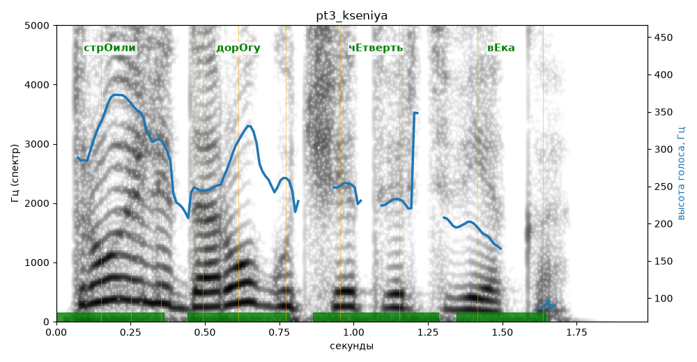

# pt3_kseniya

Голос: **silero:kseniya** · длительность 2.0 с
Естественность (UTMOS): **2.52 из 5** (живой диктор ≈ 4–4.5)
Эталон: Строили дорогу четверть века.
Распознано: Строили дорогу четверть века.
Слова: все совпали

## Ударения
(где нужно: ruaccent)

| слово | нужно | у голоса | |
|---|---|---|---|
| строили | стрОили | стрОили | ✓ |
| дорогу | дорОгу | дорОгу | ✓ |
| четверть | чЕтверть | чЕтверть | ✓ |
| века | вЕка | вЕка | ✓ |

## Интонация
- ✓ «строили дорогу четверть века.» — конец фразы понижается — звучит законченно
- Диапазон голоса 13.5 полутонов (живо), средняя высота 250 Гц

## Паузы и темп
- паузы на своих местах
- Темп 6.1 слога/с (нормально)

_Синяя линия — высота голоса. Над словами заглавная буква — где ударение должно быть; красным — голос поставил не туда (уверенно), оранжевым — возможно._
