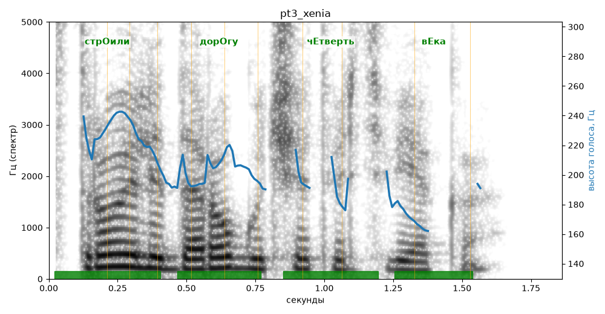

# pt3_xenia

Голос: **silero:xenia** · длительность 1.9 с
Естественность (UTMOS): **3.15 из 5** (живой диктор ≈ 4–4.5)
Эталон: Строили дорогу четверть века.
Распознано: строили дорогу четверть века.
Слова: все совпали

## Ударения
(где нужно: ruaccent)

| слово | нужно | у голоса | |
|---|---|---|---|
| строили | стрОили | стрОили | ✓ |
| дорогу | дорОгу | дорОгу | ✓ |
| четверть | чЕтверть | чЕтверть | ✓ |
| века | вЕка | вЕка | ✓ |

## Интонация
- ✓ «строили дорогу четверть века.» — конец фразы понижается — звучит законченно
- Диапазон голоса 6.1 полутонов (нормально), средняя высота 203 Гц

## Паузы и темп
- паузы на своих местах
- Темп 6.6 слога/с (быстро)

_Синяя линия — высота голоса. Над словами заглавная буква — где ударение должно быть; красным — голос поставил не туда (уверенно), оранжевым — возможно._
