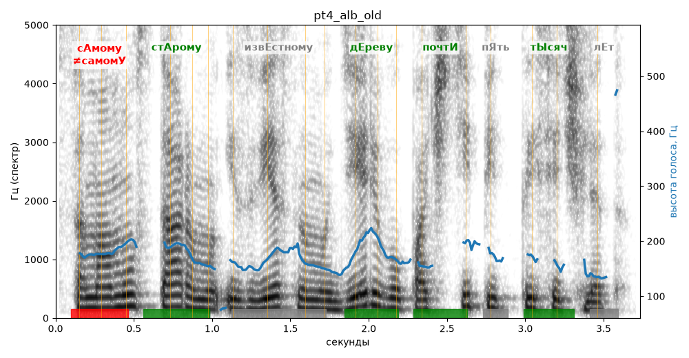

# pt4_alb_old

Голос: **Альбина (бот), как сейчас** · длительность 3.7 с
Естественность (UTMOS): **3.04 из 5** (живой диктор ≈ 4–4.5)
Эталон: Самому старому известному дереву почти пять тысяч лет.
Распознано: самому старому известному дереву почти пять тысяч лет.
Слова: все совпали

## Ударения
(где нужно: ruaccent)

| слово | нужно | у голоса | |
|---|---|---|---|
| самому | сАмому | самомУ | ✗ ОШИБКА |
| старому | стАрому | стАрому | ✓ |
| известному | извЕстному | известномУ | ? не разобрать |
| дереву | дЕреву | дЕреву | ✓ |
| почти | почтИ | почтИ | ✓ |
| тысяч | тЫсяч | тЫсяч | ✓ |

## Интонация
- ✓ «самому старому известному дереву почти пять тысяч лет.» — конец фразы понижается — звучит законченно
- Диапазон голоса 6.9 полутонов (нормально), средняя высота 169 Гц

## Паузы и темп
- паузы на своих местах
- Темп 5.4 слога/с (нормально)

_Синяя линия — высота голоса. Над словами заглавная буква — где ударение должно быть; красным — голос поставил не туда (уверенно), оранжевым — возможно._
