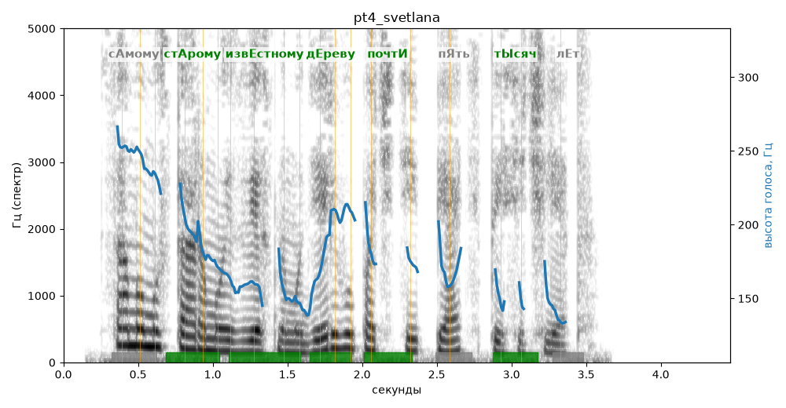

# pt4_svetlana

Голос: **edge:ru-RU-SvetlanaNeural** · длительность 4.5 с
Естественность (UTMOS): **3.73 из 5** (живой диктор ≈ 4–4.5)
Эталон: Самому старому известному дереву почти пять тысяч лет.
Распознано: Самому старому известному дереву почти 5 тысяч лет.
Расхождения в словах: «пять» → «5»

## Ударения
(где нужно: ruaccent)

| слово | нужно | у голоса | |
|---|---|---|---|
| самому | сАмому | самОму | ? не разобрать |
| старому | стАрому | стАрому | ✓ |
| известному | извЕстному | извЕстному | ✓ |
| дереву | дЕреву | дЕреву | ✓ |
| почти | почтИ | почтИ | ✓ |
| тысяч | тЫсяч | тЫсяч | ✓ |

## Интонация
- ✓ «самому старому известному дереву почти пять тысяч лет.» — конец фразы понижается — звучит законченно
- Диапазон голоса 9.9 полутонов (живо), средняя высота 172 Гц

## Паузы и темп
- паузы на своих местах
- Темп 6.3 слога/с (нормально)

_Синяя линия — высота голоса. Над словами заглавная буква — где ударение должно быть; красным — голос поставил не туда (уверенно), оранжевым — возможно._
