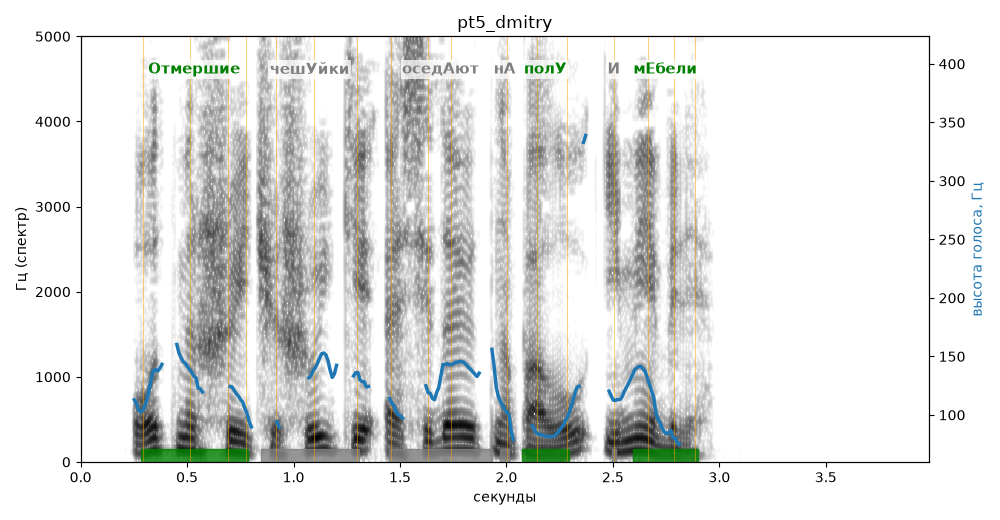

# pt5_dmitry

Голос: **edge:ru-RU-DmitryNeural** · длительность 4.0 с
Естественность (UTMOS): **3.78 из 5** (живой диктор ≈ 4–4.5)
Эталон: Отмершие чешуйки оседают на полу и мебели.
Распознано: Отмершие чешуйки оседают на полу и мебели.
Слова: все совпали

## Ударения
(где нужно: ruaccent)

| слово | нужно | у голоса | |
|---|---|---|---|
| отмершие | Отмершие | Отмершие | ✓ |
| чешуйки | чешУйки | чешуйкИ | ? не разобрать |
| оседают | оседАют | — | ? |
| полу | полУ | полУ | ✓ |
| мебели | мЕбели | мЕбели | ✓ |

## Интонация
- ✗ «отмершие чешуйки оседают на полу и мебели.» — конец фразы не понижается — звучит незаконченно / как перечисление
- Диапазон голоса 10.3 полутонов (живо), средняя высота 122 Гц

## Паузы и темп
- паузы на своих местах
- Темп 7.0 слога/с (быстро)

_Синяя линия — высота голоса. Над словами заглавная буква — где ударение должно быть; красным — голос поставил не туда (уверенно), оранжевым — возможно._
