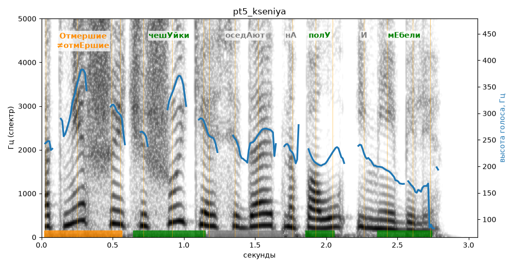

# pt5_kseniya

Голос: **silero:kseniya** · длительность 3.1 с
Естественность (UTMOS): **3.85 из 5** (живой диктор ≈ 4–4.5)
Эталон: Отмершие чешуйки оседают на полу и мебели.
Распознано: Отмершие чешуйки оседают на полу и мебели.
Слова: все совпали

## Ударения
(где нужно: ruaccent)

| слово | нужно | у голоса | |
|---|---|---|---|
| отмершие | Отмершие | отмЕршие | ✗? возможно — послушать |
| чешуйки | чешУйки | чешУйки | ✓ |
| оседают | оседАют | — | ? |
| полу | полУ | полУ | ✓ |
| мебели | мЕбели | мЕбели | ✓ |

## Интонация
- ✓ «отмершие чешуйки оседают на полу и мебели.» — конец фразы понижается — звучит законченно
- Диапазон голоса 14.1 полутонов (живо), средняя высота 238 Гц

## Паузы и темп
- паузы на своих местах
- Темп 6.8 слога/с (быстро)

_Синяя линия — высота голоса. Над словами заглавная буква — где ударение должно быть; красным — голос поставил не туда (уверенно), оранжевым — возможно._
