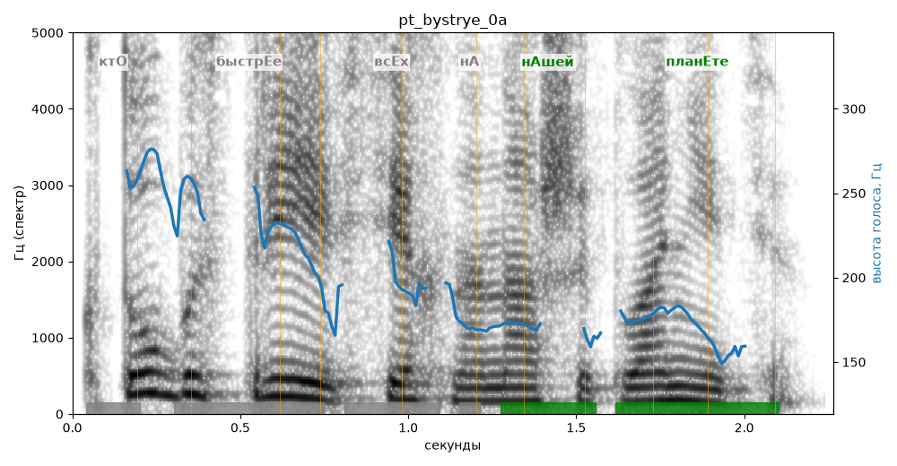

# pt_bystrye_0a

Голос: **Альбина, бот (ударения во всех словах)** · длительность 2.3 с
Естественность (UTMOS): **3.55 из 5** (живой диктор ≈ 4–4.5)
Эталон: Кто быстрее всех на нашей планете?
Распознано: Кто быстрее всех на нашей планете?
Слова: все совпали

## Ударения
(где нужно: ruaccent)

| слово | нужно | у голоса | |
|---|---|---|---|
| быстрее | быстрЕе | бЫстрее | ? не разобрать |
| нашей | нАшей | нАшей | ✓ |
| планете | планЕте | планЕте | ✓ |

## Интонация
- ✓ «кто быстрее всех на нашей планете?» — конец фразы понижается — звучит законченно
- Диапазон голоса 8.7 полутонов (живо), средняя высота 181 Гц

## Паузы и темп
- паузы на своих местах
- Темп 5.3 слога/с (нормально)

_Синяя линия — высота голоса. Над словами заглавная буква — где ударение должно быть; красным — голос поставил не туда (уверенно), оранжевым — возможно._
