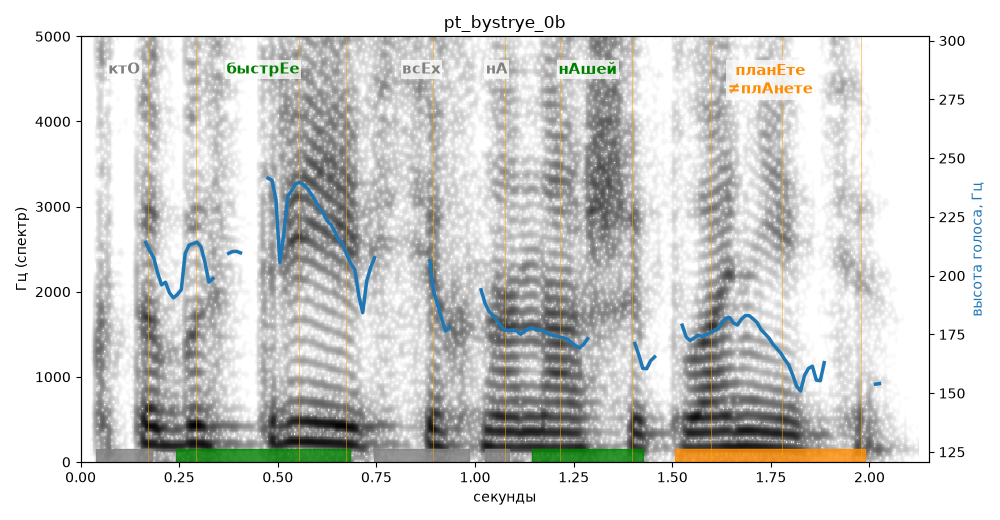

# pt_bystrye_0b

Голос: **Альбина, бот (без ударений в односложных)** · длительность 2.2 с
Естественность (UTMOS): **3.51 из 5** (живой диктор ≈ 4–4.5)
Эталон: Кто быстрее всех на нашей планете?
Распознано: кто быстрее всех на нашей планете.
Слова: все совпали

## Ударения
(где нужно: ruaccent)

| слово | нужно | у голоса | |
|---|---|---|---|
| быстрее | быстрЕе | быстрЕе | ✓ |
| нашей | нАшей | нАшей | ✓ |
| планете | планЕте | плАнете | ✗? возможно — послушать |

## Интонация
- ✓ «кто быстрее всех на нашей планете?» — конец фразы понижается — звучит законченно
- Диапазон голоса 7.0 полутонов (живо), средняя высота 181 Гц

## Паузы и темп
- паузы на своих местах
- Темп 5.6 слога/с (нормально)

_Синяя линия — высота голоса. Над словами заглавная буква — где ударение должно быть; красным — голос поставил не туда (уверенно), оранжевым — возможно._
