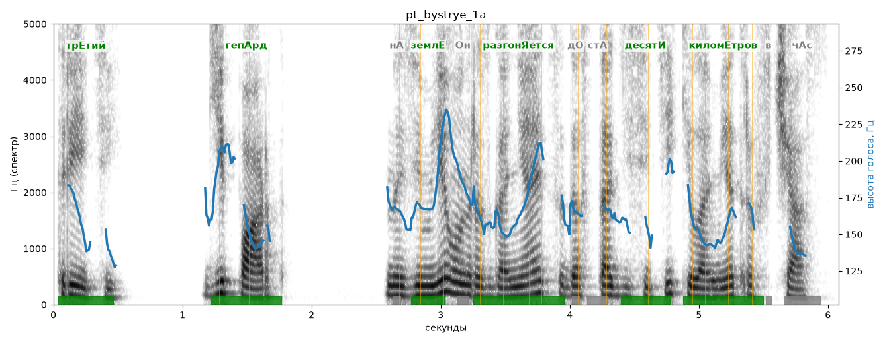

# pt_bystrye_1a

Голос: **Альбина, бот (ударения во всех словах)** · длительность 6.1 с
Естественность (UTMOS): **3.65 из 5** (живой диктор ≈ 4–4.5)
Эталон: Третий: гепард. На земле он разгоняется до ста десяти километров в час.
Распознано: Третий – гипарт. На земле он разгоняется до 110 км в час.
Расхождения в словах: «гепард» → «гипарт»; «ста десяти километров» → «110 км»

## Ударения
(где нужно: ruaccent)

| слово | нужно | у голоса | |
|---|---|---|---|
| третий | трЕтий | трЕтий | ✓ |
| гепард | гепАрд | гепАрд | ✓ |
| земле | землЕ | землЕ | ✓ |
| разгоняется | разгонЯется | разгонЯется | ✓ |
| десяти | десятИ | десятИ | ✓ |
| километров | киломЕтров | киломЕтров | ✓ |

## Интонация
- ✓ «третий гепард.» — конец фразы понижается — звучит законченно
- ✓ «на земле он разгоняется до ста десяти километров в час.» — конец фразы понижается — звучит законченно
- Диапазон голоса 7.1 полутонов (живо), средняя высота 163 Гц

## Паузы и темп
- паузы на своих местах
- Темп 5.6 слога/с (нормально)

_Синяя линия — высота голоса. Над словами заглавная буква — где ударение должно быть; красным — голос поставил не туда (уверенно), оранжевым — возможно._
